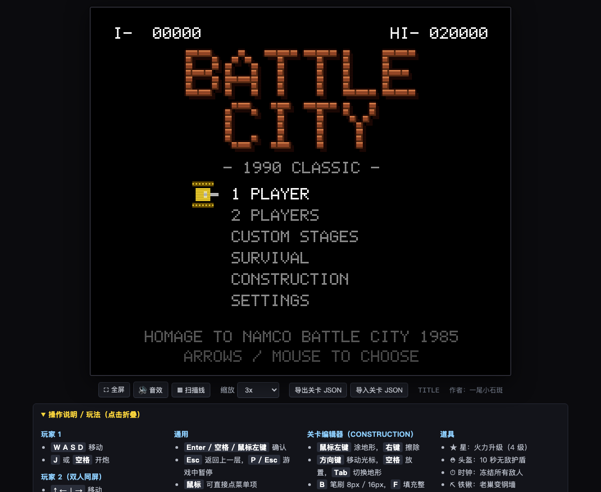
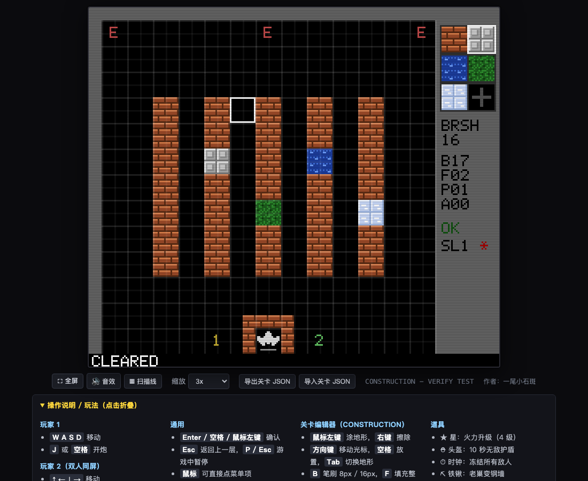

# BATTLE CITY 90 · 坦克大战

作者：**一尾小石斑** · [在线试玩](https://charrychen1024.github.io/games/battle-city/)

1990 年那款红白机《坦克大战》的完整复刻，跑在浏览器里，用键盘和鼠标玩。
零外部素材：所有像素图、字库、音效都在运行时用代码生成，整个游戏就是几个 `.js` 文件。



---

## 怎么玩

```bash
cd battle-city        # 在 Game 总目录下
./play.sh
```

脚本会起一个本地服务器并自动打开浏览器。想换端口就 `./play.sh 8123`。

也可以直接双击 `index.html`。不过 Safari 会禁掉 `file://` 下的本地存储，
那样自制关卡只在当前这次会话里有效——想长期保存自制关卡，请用 `./play.sh`。

退出：在终端按 `Ctrl+C`。

---

## 操作

| | 玩家 1 | 玩家 2 |
|---|---|---|
| 移动 | `W` `A` `S` `D` | `↑` `←` `↓` `→` |
| 开炮 | `J` 或 `空格` | `小键盘 0` / `右 Shift` / `/` |

- `Enter` / `空格` / **鼠标左键** —— 确认，菜单项可以直接用鼠标点
- `P` 或 `Esc` —— 暂停；暂停时按 `Q` 退回标题画面
- 页面下方工具条：全屏、音效开关、CRT 扫描线、缩放倍率

---

## 玩法

守住底部的老鹰，打光每关 20 辆敌方坦克。老鹰被击毁或者坦克全部打完，游戏结束。
**注意：你自己的炮弹一样能打掉老鹰**，和原版一个脾气。

### 四种敌人

| | 名称 | 特点 | 分值 |
|---|---|---|---|
| 灰 | BASIC | 普通 | 100 |
| 白 | FAST | 跑得快 | 200 |
| 蓝 | POWER | 炮弹快 | 300 |
| 绿→黄→橙→红 | ARMOR | 要打四发，每中一发变色 | 400 |

闪红光的敌人身上带道具，打掉它道具就会掉在场上。每关的第 4、11、18 辆是带道具的。

### 六种道具

| 道具 | 效果 |
|---|---|
| ★ 星 | 火力升级，共 4 级：加速炮弹 → 双发同屏 → 能打碎钢板 |
| ⛑ 头盔 | 10 秒无敌护盾 |
| ⏱ 时钟 | 冻结全场敌人 10 秒 |
| ⛏ 铁锹 | 老巢砖墙变钢墙 18 秒，快结束时会闪烁提醒 |
| 💣 手雷 | 场上敌人全灭 |
| 🚙 坦克 | 加一条命 |

吃到任何道具另加 500 分。被击毁后火力等级清零，和原版一致。

### 六种地形

砖墙（可打穿，按 8 像素碎块）、钢板（4 级火力才打得碎）、河流（坦克过不去，炮弹能飞过）、
树林（盖在坦克上方，可以藏）、冰面（会打滑），以及空地。

---

## 自定义关卡

标题画面选 **CONSTRUCTION** 进编辑器。



- **鼠标左键涂地形，右键擦除**，按住拖动可以连续画
- `方向键` 移动光标，`空格` 放置，`Delete` 擦除
- `Tab` / `Q` / `E` 切换地形，也可以直接点右侧的地形板
- `B` 切换 8px / 16px 笔刷 —— 16px 是原版的格子大小，8px 能做出原版那种半格墙
- `F` 整屏填充，`C` 清空，`N` 新建
- `1` `2` `3` `4` 调整四种敌人的数量，总数始终锁定在 20
- `S` 保存到槽位，`L` 打开存档列表（`D` 删除），`R` 重命名
- `T` 立即试玩当前关卡，`H` 看完整按键表，`Esc` 退出

右下角的 **OK / BAD** 是实时可玩性检查：它会用洪水填充算出
"把砖墙打穿之后，敌人能不能摸到老鹰、玩家能不能从出生点出去"。
显示 BAD 的关卡不让试玩，省得做出一张死局。

`E` 标记是敌人出生点，`1` `2` 是玩家出生点，这几格永远会被清空（原版也是这么处理的）。

### 存取与分享

工具条上的 **导出关卡 JSON / 导入关卡 JSON** 可以把自制关卡存成文件带走或分享。
格式很简单：

```json
{
  "format": "battle-city-90",
  "version": 1,
  "stages": [
    {
      "name": "MY STAGE",
      "rows": ["26 个字符 × 26 行", "..."],
      "comp": [14, 4, 2, 0]
    }
  ]
}
```

`rows` 里一个字符 = 8×8 像素：`.` 空地、`B` 砖、`S` 钢、`W` 水、`T` 树、`I` 冰。
`comp` 是 `[普通, 快速, 火力, 装甲]` 的数量，加起来 20。

标题画面的 **CUSTOM STAGES** 可以单关游玩，也可以 **PLAY ALL** 把自制关卡串成一个战役，
全部通关会有 ALL CLEAR 画面。

---

## 还原了哪些细节

- 13×13 的战场，砖墙按 8 像素碎块逐块打掉，一发打出 16 像素宽的缺口，两发才能通车
- 转向时自动吸附到 8 像素网格——原版那种"对准缝隙钻进去"的手感全靠这个
- 每关 20 辆敌人，同屏最多 4 辆（双人时 6 辆），从左、中、右三个点轮流出现
- 出生时的星形闪烁动画、复活后的短暂无敌
- 装甲坦克四条血，每挨一发换一次颜色
- 关卡之间的灰色幕布过场、逐项累加的结算画面、GAME OVER 从下方升起
- 双人同屏合作，**误伤队友只会把他定住几秒，不会打死**（原版的合作设计）
- 老鹰的砖墙护甲是 8 像素厚的，不是一整格

## 加了哪些私货

- **关卡编辑器**比原版强：鼠标涂抹、8/16 双笔刷、敌人配比可调、实时可玩性校验、一键试玩、JSON 导入导出
- **SURVIVAL 无尽模式**：程序生成左右对称的关卡，难度随波次上升，每 4 波补一条命
- **自制关卡战役**：把自己做的关卡串起来连着打
- 屏幕震动、爆炸粒子、可开关的 CRT 扫描线
- 设置项（音效 / 扫描线 / 起始关卡）和最高分会被记住

---

## 自动化验证

```bash
npm run levels    # 35 个关卡的几何与连通性校验
npm run verify    # 上面这项 + 真实浏览器里的 90 项端到端测试
```

`tools/verify.js` 用 Playwright 开一个真 Chromium，逐帧驱动游戏并检查内部状态，覆盖：

- 启动无报错、精灵图生成、画布缩放
- 移动、边界碰撞、8 像素吸附
- 开炮、砖块破碎范围、钢板对 0 级 / 3 级火力的不同反应
- 敌人刷新节奏与同屏上限
- 六种道具逐个验证实际效果
- 过关结算的逐项累加与计分（100/200/300/400）
- 老鹰被毁 → GAME OVER → 结算 → 回标题的完整链路
- 双人模式与"误伤只定身"
- **35 个关卡全部实例化并空跑 2 秒**
- 编辑器：鼠标涂抹、笔刷、填充、清空、存读、JSON 往返、一键试玩
- **脚本机器人实打实把第 1 关 20 辆坦克全部清掉**
- **18000 帧（约 5 分钟）随机输入浸泡测试，不崩不卡死**
- 单帧 update+draw 的耗时预算
- 关掉测试钩子后，真实 requestAnimationFrame 主循环的帧率，以及真实按键能不能开车开炮

每次跑完会把截图写进 `screenshots/`。

---

## 目录结构

```
index.html            页面与脚本加载顺序
css/style.css         页面外壳
js/core.js            常量、几何、调色板、工具函数
js/font.js            5×7 点阵字库
js/sprites.js         程序化像素美术（坦克/地形/老鹰/道具/爆炸）
js/audio.js           WebAudio 合成音效
js/storage.js         localStorage 封装（带内存兜底）
js/input.js           键盘与鼠标
js/levels.js          35 个内置关卡、解析器、可玩性校验、随机关生成
js/entities.js        坦克、子弹、道具、爆炸
js/battle.js          战场：地形、碰撞、刷怪、HUD
js/editor.js          关卡编辑器
js/ui.js              界面状态机与各个画面
js/main.js            启动、缩放、固定步长主循环
tools/serve.js        本地静态服务器
tools/validate-levels.js  关卡校验
tools/verify.js       浏览器端端到端验证
play.sh               一键启动
```

---

本作是向 Namco 1985 年《Battle City》致敬的同人复刻，代码与美术均为原创实现，
不包含原作的任何素材数据。
