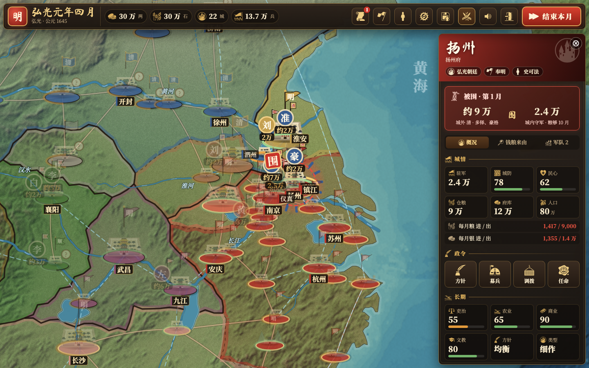

# 南明 · 甲申以后

“北京失守的消息传到南京。”这是一款 1644—1662 年的历史地图策略游戏。玩家从甲申年五月出发，在全国地图上经营城池、调配人物、用兵和交涉。每月一回合。

当前版本是**弘光朝廷十二回合试玩**，从甲申五月玩到乙酉四月。清、大顺、张献忠部、福建郑氏由电脑控制，江北四镇、左良玉部、各省官府奉朝廷号令。另附一份**地图样稿**：乙酉四月，扬州被围。



## 怎么玩

```bash
./play.sh          # 首次会自动安装依赖并构建，默认端口 8110
```

也可以在线玩：<https://charrychen1024.github.io/games/nanming/dist/>

一个月的流程：
1. **读军情**：每月开头先弹出要闻，左侧是全部军情卡片。点地名回到出事的城。
2. **点城池**：右侧卡片显示实际控制者、所奉政权、驻军、城防、钱粮。“钱粮来由”逐项列出每一笔变化，红框是你的命令造成的。
3. **下命令**：
   - 城池：方针、募兵、调拨、任命、劝降。
   - 军旗：行军、进攻、攻城、围困。
   - 江北诸镇要“号令”，听不听、听几分，看服从度、利益、粮饷和督师。
4. **结束本月**：各方同时行动，依次结算交涉 → 行军 → 野战 → 围城 → 内政钱粮 → 史事线索。玩家参与的战斗进入战斗场景（Phaser 3 引擎）：两军在拟物的战场上列阵交锋，攻城时有城墙、城楼、云梯和炮火。三路各下一令，可以用计策，也可以交给部将代打。

操作：拖动平移，滚轮缩放，`R` 开关军情，`Esc` 取消或关闭。每月结算后自动存档，另有三个手动存档位，可以导出、导入存档文件。

## 玩法要点

- **易主**：只有陷城、献城、正式归附才改变城池控制权。野战失利只会让城池失去屏障。
- **三层归属**：城池记录实际控制者，势力记录所奉政权。例如凤阳由刘良佐部实控，归附后改奉清朝。
- **因果账**：钱粮、人口、民心、驻军、城防的每笔变动都记下来源。缺粮急报能追到当初那道募兵令。
- **史事**：本局走向合乎史实时触发，同一事件只触发一次；不合时不发生，或改写后发生。例如扬州被围而未破，“扬州之战”就改写为死守。
- **线索**：党争、三案、剃发令等按时出现，并在人物态度上留下可查的记录。
- **历法**：界面按所奉政权显示年号与农历月，闰月单算一回合。

## 开发

设计依据见 [`Docs/南明游戏制作要求.md`](Docs/南明游戏制作要求.md)（v0.3），实现对照见 [`Docs/实现说明.md`](Docs/实现说明.md)，其中有对[独立审查](Docs/十二回合试玩独立审查-2026-11-23.md)的逐项处理记录。

```bash
npm install
npm run dev        # 开发服务器
npm test           # 规则核心测试（vitest，含制作要求第六节的验收）
npm run build      # 类型检查 + 构建到 dist/（构建产物提交到仓库，供 GitHub Pages 使用）
npm run e2e        # 端到端测试：用浏览器真实操作走完十二个月，截图写入 test-results/
npx tsx tools/sim.ts 12 1644   # 无界面模拟，打印每月军情，用于调平衡
npx tsx tools/compare.ts 30    # 成对局面：同一组种子比较放任、增援、补给、交涉四种策略
```

浏览器测试需要 Playwright。`tools/pw.mjs` 依次尝试环境变量 `PLAYWRIGHT_CORE`、项目依赖 `playwright-core`、本机 Homebrew 安装，都没有时可以这样装：

```bash
npm i -D playwright-core && npx playwright-core install chromium
```

```
nanming/
├── src/core/      规则核心：不碰页面，局势是纯 JSON，结算可复现
├── src/data/      地理、势力、人物、开局、史事与线索、预设局面
├── src/render/    地图绘制（Canvas）：真实高程晕渲与设色、城池标志
├── src/ui/        界面（GSAP 动画）、战斗场景（Phaser 3）、图标、声音
├── tests/         vitest 测试
├── tools/         本地服务器、端到端测试、截图、模拟、素材抽取
├── assets/CREDITS.md  素材来源与授权
└── Docs/          制作要求与实现说明
```

作者：一尾小石斑。素材授权见 [`assets/CREDITS.md`](assets/CREDITS.md)。
