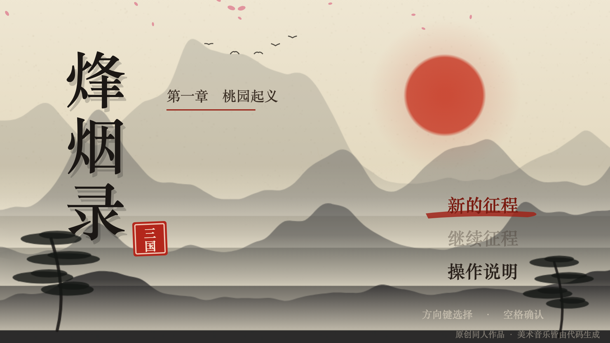

# 烽烟录 · 三国（全八部，共三十四章 + 番外）

作者：**一尾小石斑** · [在线试玩](https://charrychen1024.github.io/games/sanguo/)

一款原创的三国题材日式回合制 RPG，跑在浏览器里。从桃园结义一直讲到三分归晋，故事已经完整收尾。
玩法上致敬童年的三国 RPG：兵力就是血量、军师施展策略、刘关张带队闯营。
人物、建筑、地形、战斗特效、音乐和音效**全部由代码实时生成**，没有任何图片或音频素材。



## 怎么玩

```bash
cd sanguo          # 在 Game 总目录下
./play.sh          # 启动本地服务器并自动打开浏览器（默认端口 8088）
```

也可以直接双击 `index.html`（Safari 在 `file://` 下可能无法长期存档，建议用 `./play.sh`）。

### 章节选择

标题画面的「章节选择」可以直接从玩到过的任意一章开始。章节随主线推进解锁：新玩家只能选第一章，玩到第几章就开放到第几章，通关后全部开放；没解锁的章节显示为「？？？？」，不剧透标题。进度记在浏览器里，与存档位无关（旧版本的玩家会按现有存档自动补上）。

从某章开始时，等级、在队部将、护甲和一些药品都按那一章的进度自动配好，方便回顾某一段剧情。

## 操作

| 按键 | 作用 |
|---|---|
| 方向键 / WASD | 移动、选择 |
| 空格 / Enter / Z | 确认、调查、对话 |
| Esc / X | 取消；在地图上打开「军务」菜单（随时记录 / 读取进度） |
| 按住 Shift | 奔跑 |
| M | 静音 / 取消静音 |

## 章节

共三十四章（第一部五章、第二部五章、第三部三章、第四部四章、第五部五章、第六部四章、第七部四章、第八部四章），章与章之间自动衔接，等级、道具、金钱全部继承。

| 章 | 标题 | 地点 | 主要剧情 |
|---|---|---|---|
| 一 | 桃园起义 | 桃园、涿县、大兴山 | 桃园结义，招揽简雍，讨伐黄巾程远志 |
| 二 | 黄巾覆灭 | 广宗、曲阳村、阳城谷 | 拜见恩师卢植，以猪羊狗血破张宝妖术，卢植被诬下狱，救董卓反遭轻慢 |
| 三 | 虎牢关 | 酸枣联军大营、虎牢关 | 关羽单挑华雄（温酒斩华雄），刘关张三英战吕布 |
| 四 | 徐州 | 北平、北海、徐州、郯城 | 赵云加入，北海斩管亥，击退夏侯惇，陶谦三让徐州 |
| 五 | 白门楼 | 小沛、下邳 | 兄弟如手足，辕门射戟，水淹下邳，高顺、张辽、陈宫，白门楼决战吕布 |
| 六 | 衣带诏 | 许都、徐州 | 学圃韬晦，衣带诏，青梅煮酒论英雄，截击袁术，斩车胄，夜袭曹营兄弟失散 |
| 七 | 千里走单骑 | 五关 | **关羽单人章节**：过五关斩六将（孔秀、韩福、卞喜、王植、秦琪） |
| 八 | 古城会 | 古城、卧牛山 | 张飞疑关羽，三通鼓斩蔡阳，兄弟重逢，赵云归来 |
| 九 | 三顾茅庐 | 新野、隆中、博望坡 | 徐庶破八门金锁阵、走马荐诸葛，三顾茅庐（第二次大雪），隆中对，诸葛亮加入，博望坡火攻 |
| 十 | 长坂坡 | 当阳 | **赵云单人章节**：单骑救主，糜夫人托孤，夺青釭剑，张飞据水断桥一声断喝 |
| 十一 | 东风 | 柴桑、三江口、南屏山 | **诸葛亮孤身入江东**：舌战群儒（选择题问答），智激孙权、周瑜，草船借箭（大雾江战），苦肉计，七星坛借东风，赵云接应 |
| 十二 | 赤壁 | 夏口、赤壁、乌林、华容道 | 孔明调兵遣将，沿着燃烧的连环船杀上曹军旗舰，乌林战徐晃、葫芦口战许褚，关羽华容道义释曹操 |
| 十三 | 荆南 | 零陵、桂阳、长沙 | 邢道荣；赵云单挑陈应、拒娶樊氏；关羽单挑黄忠、黄忠射盔缨、魏延反韩玄；黄忠加入 |
| 十四 | 甘露寺 | 南徐、江岸 | **刘备、赵云二人行**：三个锦囊；乔国老、甘露寺国太相婿、贾华伏兵、试剑石（砍过后裂成十字）；孙夫人加入；夫人喝退徐盛丁奉；刘郎浦大败周瑜——"赔了夫人又折兵" |
| 十五 | 凤雏 | 荆州、耒阳、涪城、长江 | 张飞单人访耒阳，庞统半日断百日公事、加入；张松献西川地理图；魏延加入、刘备入川；涪城会魏延舞剑；**赵云单人截江夺阿斗**，孙夫人归吴 |
| 十六 | 落凤坡 | 西川、落凤坡、巴郡 | 涪关诛杨怀高沛；黄忠魏延争功破冷苞；**庞统骑白马走小路，殒命落凤坡**；张飞单人智取巴郡、义释严颜；金雁桥擒张任 |
| 十七 | 成都 | 葭萌关、成都 | 魏延战马岱；**张飞单挑马超，挑灯夜战**（地图入夜）；李恢说降，马超加入；马超城下喝降，刘璋出降，刘备入主成都；第四部完 |
| 十八 | 单刀赴会 | 江陵、陆口 | **关羽单人章节**：诸葛瑾索荆州被拒；临江亭单刀赴会，周仓"惟有德者居之"，挽鲁肃之手退回江边，甘宁拦江 |
| 十九 | 定军山 | 汉中、定军山 | 张飞诈醉五十日破张郃；黄忠严颜火烧天荡山；**法正举旗**（选择红旗时机，时机对了夏侯渊会更弱）；黄忠单骑斩夏侯渊 |
| 二十 | 汉中王 | 汉水、斜谷 | **赵云单人**：单骑救黄忠、空营计退徐晃；斜谷战许褚，"鸡肋"杨修之死，魏延一箭射落曹操门牙；沔阳称汉中王，封五虎上将 |
| 二十一 | 水淹七军 | 樊城、罾口川 | 关平、周仓加入；关羽单挑抬棺而来的庞德，中箭；观罾口川，**水淹七军**（地图变成一片汪洋，关羽习得「威震华夏」）；擒于禁，周仓水中擒庞德；曹仁毒箭，华佗刮骨疗毒 |
| 二十二 | 麦城 | 荆襄、麦城、临沮 | 徐晃"不敢以私废公"；吕蒙白衣渡江，荆州失陷，军心离散；败走麦城，"玉可碎而不可改其白"；周仓留守，夜走临沮，潘璋伏兵；关公归天，玉泉山显圣；第五部完 |
| 二十三 | 猇亭 | 三峡、猇亭 | 张飞遇害；**关兴、张苞加入**；关公显圣，关兴单挑斩潘璋、夺回青龙刀；黄忠夜闯猇亭，中箭殒命 |
| 二十四 | 白帝城 | 夷陵、白帝城 | **火烧连营**（整张地图是燃烧的七百里连营）；赵云救驾斩朱然；陆逊追兵误入八阵图；白帝城托孤，刘备驾崩 |
| 二十五 | 南征 | 南中、泸水 | 诸葛亮南征，吕凯献图；**一擒至四擒孟获**——每次可选"放"或"斩"，孔明都说"攻心为上"；泸水白天渡河会中毒，要等半夜；孟优诈降、西洱河陷坑 |
| 二十六 | 七擒孟获 | 秃龙洞、银坑洞、盘蛇谷 | 四眼毒泉，瘴气挡路，孟节赠薤叶芸香；杨锋献孟获；祝融夫人、木鹿大王；**藤甲兵刀枪难伤、火攻速破**；火烧盘蛇谷，七擒孟获，南中平定；第六部完 |
| 二十七 | 出师 | 祁山 | 《出师表》；马超病故；夏侯楙；**七十岁的赵云单挑韩德父子**；天水战姜维，孔明用计收服，**姜维加入** |
| 二十八 | 街亭 | 街亭、西城 | **王平守街亭**：可以选择怎样劝马谡，但马谡总是不听；张郃断水，街亭失守；**空城计**——三个选项，只有"大开四门、焚香操琴"能不战退敌；挥泪斩马谡，**王平加入** |
| 二十九 | 陈仓 | 陈仓（雪地） | 赵云病逝；郝昭死守陈仓，云梯、冲车、地道都破不了城；**魏延单挑王双**；张苞坠涧病亡 |
| 三十 | 卤城 | 陇西 | 孔明装神，陇上割麦；郭淮；卤城夜破司马懿；木门道万弩射死张郃；关兴病亡；第七部完 |
| 三十一 | 上方谷 | 渭南、上方谷 | **马岱、廖化加入**；木牛流马，王平扭转木牛舌头赚走魏军粮草；司马昭劫粮；**火烧上方谷**，一场大雨救了司马懿父子 |
| 三十二 | 五丈原 | 五丈原（夜） | **七星灯禳星**（帐中有七盏大灯、四十九盏小灯）；魏兵夜袭；魏延踏灭主灯；秋风五丈原，**孔明归天**，姜维得兵书、习得「丞相遗策」；死诸葛走生仲达；魏延反，"谁敢杀我"——马岱斩之 |
| 三十三 | 洮西 | 陇右 | 王平病故，**夏侯霸加入**；姜维北伐：洮西大破王经，铁笼山围困司马昭，段谷遭邓艾 |
| 三十四 | 三分归晋 | 剑阁、绵竹 | **终章**：姜维剑阁拒钟会；邓艾偷渡阴平；**诸葛瞻单人**死守绵竹；后主出降，姜维假降，一计害三贤；尾声回到桃园；全剧终 |

每章都有自己的地貌与天气：秋日冀州、阴雨阳城谷、黄土虎牢关、雪中北平、水淹下邳、竹林隆中、火烧博望坡、大雾长江、夜烧赤壁连环船、蜀道群峰、黄昏落凤坡、火把下的葭萌关、汉水与斜谷、大雨中泛滥的罾口川、夜色里的麦城、火海般的七百里连营、瘴气弥漫的南中丛林、雪中的陈仓、陇上麦田、秋夜的五丈原、剑门关。

部将最多六人：刘备、关羽、张飞、简雍、赵云（第四章）、诸葛亮（第九章）、黄忠（第十三章，简雍留守荆州）、孙夫人（第十四章）、庞统、魏延（第十五章）、马超（第十七章）、关平和周仓（第二十一章）、关兴和张苞（第二十三章）、姜维（第二十七章）、王平（第二十八章）、马岱和廖化（第三十一章）、夏侯霸（第三十三章），终章还有诸葛瞻。
部将会随剧情离开：庞统战死落凤坡，孙夫人回东吴，关羽父子与周仓殁于麦城，张飞遇害，黄忠殒命猇亭，刘备驾崩白帝城，马超、赵云、张苞、关兴、王平先后病故，孔明薨于五丈原，魏延谋反被斩。离队的部将，护甲会自动放回行囊；长期没上场的部将再次出场时，等级会自动补到和全军接近。

## 番外 · 桃园一梦（彩蛋章节）

**怎么解锁**：打通第三十四章、看到「全剧终」之后，标题画面会多出一项「桃园一梦」，章节选择最末也会出现「番外」。解锁记录存在浏览器里，和存档无关。

**故事**：章武三年，白帝城。刘备病笃，昏昏睡去，梦回桃园——一路上走散的人都回来了，还有许多他从未见过的后来人。这是一个谁也不必死去的结局。

**玩法**（全员 Lv72、穿昭烈铠，从独立的新进度开始）：
- **全员重聚，点将出阵**：全部二十一位部将都在。找简雍「点将」，任选六人上阵，其余在候补。
- **擂台重逢**：东边擂台，五位老对手轮番上台——张宝、吕布、周瑜、曹操、司马懿，每人都有新台词（吕布：「这回没有赤兔，咱们再比一场！」）。每胜一阵自动回满。
- **两段「如果」**：东南渡口，关羽识破白衣渡江；西边七星灯，姜维给魏延开了个侧门，主灯长明。都是轻松的小剧场，各送一份补给。
- **五件旧物**：桃林里散落着发光的旧物——青龙偃月刀、丈八蛇矛、白羽扇、青釭剑、雌雄双股剑，拾起时原主人会说一句话。五件全齐，片尾会多一句话。
- **终战 · 天命**：擂台打完，结义亭前墨色翻涌，「天命」现身（水墨战场，身周墨团翻涌）。击败之后，三兄弟在桃树下对饮，刘备在白帝城醒来，随后播放片尾字幕（作者 · 一尾小石斑），章末印章为「梦醒」。

## 系统

- **兵力即血量**：兵力越少，攻击越弱（满兵力时伤害约为残兵时的 1.8 倍）。伤了要及时疗养。
- **策略值全军共用**：简雍的「火计 / 烈火 / 疗伤 / 救援」，刘备的「疗伤 / 激励」，
  关羽的「斩将」、张飞的「怒喝」都消耗同一个策略值池。客栈和浊酒可以恢复。
- **成长**：升级提升兵力上限与各项能力，到一定等级习得新策略。
- **护甲**：兵器铺的皮甲、铁甲给指定部将穿戴，提升防御。行囊里的护甲（剧情奖励、离队部将卸下的）可在军务「道具」里交给现役部将；换下的旧甲一律放回行囊。
- **藤甲兵**（第二十六章）：刀枪只能造成两成伤害，火计伤害约 2.6 倍——带上诸葛亮。
- **Boss**：兵力降到一半以下时每回合行动两次，且无法撤退（首领战的战斗菜单里，「撤退」直接显示为不可选的「无法撤退」）。有的 Boss 自带特殊规则：
  张宝有妖法护体（需先找到破法）且会剪纸成兵；华雄一战只有关羽单骑出战；
  三英战吕布只有刘关张三人；吕布、李傕、夏侯惇等打到一定程度会拨马退走。
- **续命丹**：战斗中救起兵力耗尽的部将。
- **存档**：三个手动存档位 + 一个自动存档位，存在浏览器的 localStorage 里。
  - 地图上随时按 Esc 打开「军务」→「记录进度 / 读取进度」；客栈、营地休整后也可以存。
  - 自动存档：每次过图、打赢战斗、剧情推进后，等你能操作时自动记录。
  - 战败后可以「重新挑战」（回到这场战斗开始前，兵力道具原样恢复）、「读取进度」或返回标题。
  - 标题画面有「继续征程」（读最新的存档）、「读取进度」（任选存档位）和「章节选择」（从玩到过的任意一章开始）；通关后还会多出「桃园一梦」（番外）。有存档时光标默认停在「继续征程」；新开一局、跳章或进番外会覆盖自动存档，开始前会先确认（默认取消）。
  - 浏览器拒绝写入时（隐私模式、空间已满），会明确提示「刷新后会丢失」，不会谎报已存好。
  - 打完终章（或番外）的存档会标为「已通关」，继续时重新播放结局画面。
- **战斗策略说明**：选策略时，下方显示目标范围（敌方一人 / 敌方全体 / 我方全体……）和效果说明。

## 自动化测试

测试用 Playwright 开一个真 Chromium，自动走完主线剧情、打完每一场关键战斗。

```bash
npm test          # 地图校验 + 存档测试 + 第一至三十四章主线 + 番外（全部跑完约 40 分钟；任何一项失败都以非零码退出）
npm run chapters  # 用章节选择逐章进入第二至三十四章，检查每章开场（约 3 分钟）
npm run maps      # 只校验地图：连通性、传送点、NPC 是否走得到
npm run balance   # 最新一部的 Boss 平衡统计（"只会普攻"和"会用策略"两种打法各打几次）
npm run extra     # 番外「桃园一梦」：解锁、点将、擂台五阵、如果、旧物、天命、片尾（约 3 分钟）
```

各章的测试也可以单独跑，例如 `node tools/chapters4-test.js`；加 `--balance` 会在主线后附带 Boss 平衡统计。

## 目录

```
index.html        页面与脚本加载顺序
js/engine.js      工具函数、画布缩放、输入、计时补间、场景栈、主循环
js/audio.js       WebAudio 合成：古筝、竹笛、太鼓、锣；六首五声音阶曲目与音效
js/art.js         程序化美术：Q 版人物、树木、建筑、帐篷、山、地表预渲染、战斗背景
js/art2.js        第三部美术：战船甲板与桅帆、七星坛、江面 / 大雾 / 赤壁火海战斗背景
js/art3.js        第四部以后的美术：试剑石、石碑、棺木、七星灯、落凤坡箭阵；蜀道群峰 / 落凤坡 / 葭萌关夜战 / 火烧连营背景
js/ui.js          漆器风格面板、对话框、菜单、提示框、字卡、部将状态页
js/data.js        人物造型、武将、策略、道具、敌军数据；存档、商店、军务菜单
js/data2.js       第二章以后的人物、赵云、新策略、道具与各章敌军
js/data3.js       第二部人物、诸葛亮、高阶道具、敌军；队伍暂离/归队
js/data4.js       第三部人物、黄忠、赤壁敌军、舌战群儒问答
js/data5.js       第四部人物、孙夫人、庞统、魏延、马超、西川敌军；部将离队
js/data6.js       第五部人物、关平、周仓、汉中与襄樊敌军；暂离部将补级
js/data7.js       第六部人物、关兴、张苞、夷陵吴军、南中蛮兵；藤甲兵规则
js/data8.js       第七部人物、姜维、王平、北伐魏军
js/data9.js       第八部人物、马岱、廖化、夏侯霸、诸葛瞻；五丈原到终章的敌军
js/world.js       地图结构、格子行走与队伍跟随、NPC、镜头、夜间光照、粒子
js/battle.js      回合制战斗：指令、目标选择、伤害公式、动画特效、结算升级
js/mapkit.js      地图工具箱：城墙、营寨、山林、守军、客栈商铺
js/maps.js        第一章地图与剧情
js/ch2.js～ch34.js 第二至三十四章地图与剧情
js/ex.js 番外「桃园一梦」：解锁、梦中桃园地图、点将台、擂台、旧物、天命 Boss、片尾字幕
js/scenes.js      标题、序章、结局、战败画面与流程入口
tools/serve.js    本地静态服务器
tools/shot.js     开发截图（node tools/shot.js → screenshots/）
tools/playtest.js 第一章自动通关测试
tools/chapters-test.js 第二至五章主线自动测试（--balance 附带 Boss 平衡统计）
tools/chapters2-test.js 第六至十章主线自动测试（同上）
tools/chapters3-test.js 第十一至十三章主线自动测试（同上）
tools/chapters4-test.js 第十四至十七章主线自动测试（同上）
tools/chapters5-test.js 第十八至二十二章主线自动测试（同上）
tools/chapters6-test.js 第二十三至二十六章主线自动测试（同上）
tools/chapters7-test.js 第二十七至三十章主线自动测试（同上）
tools/chapters8-test.js 第三十一至三十四章（终章）主线自动测试（同上）
tools/chapter-select-test.js 章节选择测试：每一章都能直接开场
tools/extra-test.js 番外自动测试（加 --balance 附带 Boss 平衡统计）
tools/save-test.js 存档系统测试：多存档位、自动存档、读档、战败重新挑战；审查回归（覆盖确认、写入失败提示、首领战撤退）
tools/validate-maps.js 全部地图的连通性与引用校验
tools/maps-shot.js 全部地图截图
```

## 关于原创

本作为原创同人作品。三国人物与故事取材于史书与《三国演义》（公有领域），
游戏名称、美术、音乐、地图与剧本均为原创，不包含任何既有游戏的素材。
